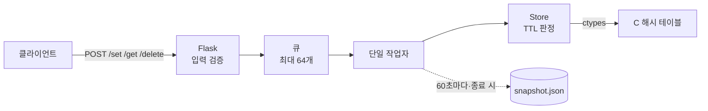

# Mini Redis

C로 직접 구현한 해시 테이블을 Python `ctypes`로 연결한 학습용 캐시 서버다.
Flask HTTP API로 문자열을 저장·조회·삭제하며, TTL 만료와 스냅샷 복구를 지원한다.



`demo/`에서는 원본 API 응답을 캐시에 재사용하고, 캐시 사용 전후의 응답 시간과 원본 호출 횟수를 비교한다.

세 API 모두 `POST`와 `Content-Type: application/json` 본문을 쓴다. `ttl`은 `1`~`2,147,483,647` 범위의 정수 초이며 생략하면 만료되지 않는다. `null`과 불리언은 거부한다.

| 요청 | 본문 | 성공 응답(200) |
| --- | --- | --- |
| `POST /set` | `{"key":"k","value":"v","ttl":10}` | `{"result":true}` |
| `POST /get` | `{"key":"k"}` | `{"result":"v"}`, 없거나 만료됐으면 `{"result":null}` |
| `POST /delete` | `{"key":"k"}` | 지웠으면 `{"result":true}`, 없었으면 `{"result":false}` |

오류는 `{"error":{"code":"..."}}` 형식이다. 깨진 JSON이나 잘못된 입력은 400, `Content-Type`이 `application/json`이 아니면 415, 큐 포화는 503이다. 전체 계약은 [HTTP·작업자·서버 수명](docs/http-and-runtime.md#http-계약)에 있다.

## 핵심 설계와 차별점

기본 구조는 djb2 해시와 체이닝을 쓰는 해시 테이블(16버킷 시작, 3/4이 차면 2배 확장)과, 조회 때 만료를 판정하고 1초마다 청소하는 TTL이다. 그 위에 다음을 더했다.

| 차별점 | 구현 | 장점 |
| --- | --- | --- |
| 메모리 부족에도 데이터 보존 | 필요한 메모리를 모두 할당한 뒤에야 테이블에 반영 | 저장이 실패해도 테이블이 반쯤 바뀐 채 남지 않아 기존 캐시를 계속 쓴다 |
| 락 없는 C 테이블 | 모든 요청을 큐에 넣고 작업자 1개만 C를 호출 | C 코드가 단순하고 요청이 섞여 메모리가 깨질 일이 없다. 과부하는 `503 busy`로 바로 알린다 |
| 어떤 문자열도 저장 | 길이 기반 바이트 비교, `strlen`·`strcmp` 미사용 | 빈 문자열·NUL·이모지가 든 값도 잘리지 않고 그대로 캐시한다 |
| 저장 중 꺼져도 안전한 스냅샷 | 임시 파일에 쓰고 `fsync` 후 `os.replace`로 교체 | 저장 도중 꺼져도 직전 스냅샷이 남아 재시작 때 복구한다 |
| C↔Python 구조체 일치 | C의 `sizeof`·`offsetof`를 출력하는 확인 프로그램 | 구조체 배치가 어긋나 엉뚱한 메모리를 읽는 ctypes 버그를 미리 잡는다 |
| 효과를 숫자로 확인 | 응답 시간과 원본 호출 수를 함께 세는 벤치마크 | 응답 약 6배 단축, 원본 호출 50회 → 0회처럼 효과를 숫자로 보여 준다(아래 측정) |

## 진행 상태

- **완료:** C 해시 테이블과 ctypes 연결, Store·TTL·청소, HTTP API, 단일 작업자, 스냅샷·복구, 캐시 재사용·명시적 무효화 시연(D1·D2), 캐시 사용·미사용 성능 비교(D3, MR-10).
- **남은 일:** Linux에서의 기능 동작 확인. 2026-11-18 확인은 Windows에서만 했다(아래 [테스트](#테스트)).

## 빠른 시작

CPython 3.12(64비트, 일반 GIL 빌드)와 C 컴파일러가 필요하다.
지원 대상은 Windows x64·Linux x86-64다.

### 1. 설치

모든 명령은 저장소 루트에서 실행하며, 새 터미널을 열 때마다 가상환경을 활성화한다.

```bash
python -m venv .venv
# Linux: source .venv/bin/activate
# PowerShell: .venv\Scripts\Activate.ps1
pip install -e ".[test]"
```

### 2. C 라이브러리 빌드

패키지 설치와 C 빌드는 별개다. 사용하는 환경의 명령 하나를 실행한다.

```bash
# Linux · GCC
gcc -std=c11 -O2 -Wall -Wextra -fPIC -shared -o mini_redis/_hashtable.so src/hashtable.c

# Windows · MinGW-w64 x64 GCC
gcc -std=c11 -O2 -Wall -Wextra -DHT_BUILD_DLL -shared -o mini_redis/_hashtable.dll src/hashtable.c

# Windows · MSVC (x64 개발자 PowerShell)
cl /nologo /std:c11 /O2 /W4 /DHT_BUILD_DLL /LD src\hashtable.c /Femini_redis\_hashtable.dll
```

### 3. 서버 실행

```bash
python -m mini_redis --data-dir ./data
```

`127.0.0.1:5000`에서 실행된다. Ctrl+C로 종료하면 `snapshot.json`에 저장하고, 같은 디렉터리로 재시작하면 복구한다. 강제 종료 시 최종 저장은 보장하지 않는다.

## 캐시 시연·성능 비교

캐시 서버를 실행한 상태에서 별도 터미널에 원본 API를 띄운다.

```bash
python demo/origin.py --delay 0.05
```

다른 터미널에서 같은 키를 두 번 조회하면 원본 대신 캐시를 재사용한다. `invalidate`로 캐시를 명시적으로 지울 수 있다.

```bash
python demo/client.py --cache http://127.0.0.1:5000 --origin http://127.0.0.1:8001 get weather
python demo/client.py --cache http://127.0.0.1:5000 --origin http://127.0.0.1:8001 get weather
python demo/client.py --cache http://127.0.0.1:5000 --origin http://127.0.0.1:8001 invalidate weather
```

성능 비교는 캐시 미사용·첫 미적중 포함·전부 적중을 같은 결과로 측정하고 JSON으로 출력한다.

```bash
python demo/benchmark.py --cache http://127.0.0.1:5000 --origin http://127.0.0.1:8001 --requests 10 --repeats 2
```

`--delay 0.05`는 원본 비용을 흉내 낸 50ms 지연이다. 측정 중에는 다른 요청을 보내지 않는다. 자세한 옵션은 각 스크립트의 `--help`에서 확인할 수 있다.

위 명령은 짧게 확인하는 예시다. 아래 표는 2026-11-18 Windows 11 x64, CPython 3.12.10에서 `--delay 0.05`로 띄운 원본에 다음 명령으로 측정한 결과이며, 평균 응답은 반복 3회의 범위다.

```bash
python demo/benchmark.py --cache http://127.0.0.1:5000 --origin http://127.0.0.1:8001 --requests 50 --repeats 3
```

| 단계 | 평균 응답 | 원본 호출(50회 요청당) |
| --- | --- | --- |
| 캐시 미사용(원본 직접) | 59~66ms | 50 |
| 캐시 첫 미적중 포함 | 9~12ms | 1 |
| 캐시 전부 적중 | 9~11ms | 0 |

## 테스트

서버를 종료한 뒤 위 빌드 명령에 `-DMINI_REDIS_TESTING=1`(MSVC: `/DMINI_REDIS_TESTING=1`)을 추가해 시험 빌드한다.

```bash
python -m pytest -q
python demo/benchmark.py --self-check
```

서버·시연·측정 전에는 일반 빌드로 되돌린다. Windows 종료 프로세스 시험에는 공유 콘솔이 필요하다.
ABI 확인은 `tests/abi_probe.c`를 컴파일해 출력한 크기·오프셋을 `mini_redis/hashtable.py`의 ctypes 선언과 대조한다.

2026-11-18 Windows 11 x64(CPython 3.12.10, MinGW-w64 GCC 16.1.0)에서 위 두 명령이 `369 passed`, `{"self_check": "ok", "checks": 11}`로 통과했다. 같은 날 Linux에서는 실행하지 않았다.

## 문서

- [설계 요약과 호출 흐름](docs/overview.md)
- [C 해시 테이블·ctypes·측정](docs/c-hashtable-and-bindings.md)
- [Store·TTL·스냅샷·소비자](docs/store-and-snapshots.md)
- [HTTP·작업자·서버 수명](docs/http-and-runtime.md)
- [작업 목록](docs/issues.md) · [협업 규칙](CONTRIBUTING.md)
