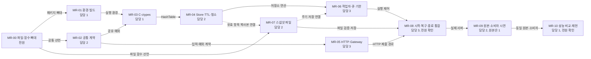

# Issues

## 작업 목록

`MR-00` 등의 번호는 이 문서 안에서 사용하는 작업 식별자이며 실제 GitHub 이슈 번호가 아니다. 파일 경로는 구현 저장소 루트 기준이다. 체크리스트는 구현과 실행 검증의 완료 조건이며 현재 통과 기록이 아니다. 맨 처음 MR-00에서 파일과 함수 뼈대를 맞추고 각 기능 이슈에서 실제 처리와 테스트 본문을 채운다.

| 번호    | 작업               | 주 담당         | 실제 연결·완료에 필요한 작업                                         |
| ----- | ---------------- | ------------ | -------------------------------------------------------- |
| MR-00 | 파일·클래스·함수 뼈대와 선언 검사 | 전원, 공통 선언 조정은 2 | 독립 착수. C 빌드·서버 실행은 완료 조건이 아님 |
| MR-01 | 패키지·C 빌드와 테스트 환경 | 1            | 최소 C 실행 확인은 MR-03과 함께 수행                                 |
| MR-02 | 공유 입력·예외 계약      | 2            | 독립 작성 가능                                                 |
| MR-03 | C 테이블과 ctypes 연결 | 1            | MR-02의 공유 예외, MR-01의 실행 환경                               |
| MR-04 | Store와 TTL·청소    | 2            | MR-02, MR-03                                             |
| MR-05 | HTTP와 Gateway    | 3            | MR-02. 실제 큐 연결은 MR-06                                    |
| MR-06 | 단일 작업자·큐·주기 제어   | 3            | MR-03·MR-04. 스냅샷 실제 호출은 MR-07                            |
| MR-07 | 스냅샷 파일 저장·검증     | 2            | 파일 단위 작성은 독립 가능. 상태 확보는 MR-04, 복구 게시와 주기 실행은 MR-06·MR-08 |
| MR-08 | 서버 시작·복구·종료 통합   | 3            | MR-03~MR-07                                              |
| MR-09 | 원본 API와 소비자 시연   | 2, 원본 API는 1 | 실제 시연은 MR-08                                             |
| MR-10 | 성능 비교와 재현 기록     | 1            | MR-08·MR-09                                              |

### 이슈 순서와 의존성

- **실선:** 실제 연결·실행 검증에 필요한 코드나 환경의 제공 방향이다. 앞 이슈 전체를 닫아야 뒤 이슈의 작성을 시작할 수 있다는 뜻은 아니다. 경로로 드러나는 간접 의존성은 화살표를 중복하지 않았다.
- **점선:** 독립 작성 가능한 부분을 실제 상태·주기 실행에 연결하는 의존성이다. MR-07의 파일 단위 구현은 MR-04를 기다리지 않고 시작할 수 있고, MR-06의 요청·청소 처리는 MR-07 없이도 작성할 수 있다.
- **최초 작업:** MR-00에서 파일·함수 선언과 import 경계를 맞춘다. 이후 MR-01의 환경 준비, MR-02의 공통 계약, MR-07의 파일 형식·기록 시험을 병렬 진행한다. MR-05는 Gateway 대체 객체로 HTTP 변환 시험부터 작성한다.
- **합류:** MR-05·MR-06에서 메모리 저장·조회·삭제의 첫 HTTP 연결을 먼저 확인하고, MR-08에서 스냅샷·복구·최종 저장까지 합친다. MR-01의 최소 C 검증은 MR-03과 함께 확인하므로 서로의 전체 완료를 기다리는 순환 의존으로 취급하지 않는다.

담당 1은 C 테이블·ctypes·빌드·원본·측정, 담당 2는 공통 검증·Store·파일·소비자, 담당 3은 HTTP·Gateway·작업자·서버 수명을 맡는다. 각자 오류와 경계 테스트를 작성한다. 통합 테스트는 담당 3이 파일 수정을 조정하지만, C 실패는 담당 1, 파일·복구·무효화는 담당 2가 함께 작성·확인한다.

설치와 빌드는 실제 실행 시험의 조건이지 이슈 작성의 선행 조건이 아니다. HTTP 변환과 파일 형식 등 독립 단위는 병렬 작성한다. 실행하지 못한 시험은 미완료로 남기고 대체 객체 통과를 실제 통합 통과로 표시하지 않는다.

## MR-00. 파일·클래스·함수 뼈대와 선언 검사

**담당:** 전원. 담당 1은 C·ctypes·패키지·원본·측정, 담당 2는 공통 타입·예외·Store·파일·소비자, 담당 3은 Gateway·Runtime·HTTP·진입점 선언을 작성한다. 공통 선언은 담당 2가 조정한다.

**대상 파일**

- 담당 1: `src/hashtable.h`, `src/hashtable.c`, `mini_redis/hashtable.py`, `mini_redis/__init__.py`, `pyproject.toml`, `.gitignore`, `README.md`, `demo/origin.py`, `demo/benchmark.py`, `tests/test_hashtable.py`, `tests/abi_probe.c`.
- 담당 2: `mini_redis/contracts.py`, `mini_redis/store.py`, `mini_redis/snapshot.py`, `demo/client.py`, `tests/test_contracts.py`, `tests/test_store.py`, `tests/test_snapshot.py`, `tests/conftest.py`.
- 담당 3: `mini_redis/gateway.py`, `mini_redis/runtime.py`, `mini_redis/http.py`, `mini_redis/__main__.py`, `tests/test_gateway.py`, `tests/test_http.py`, `tests/test_runtime.py`, `tests/test_integration.py`.

**의존 계약:** 설계 문서 5.4절의 생성자·함수·입력·반환·예외와 3.4절 C 구조체·함수 원형. 새로운 동작이나 외부 API를 임의로 추가하지 않는다.

**작업 범위**

- 공통 `Operation`, `Entry`, `MISSING`, `validate_key/validate_set`과 공유 예외를 먼저 선언한다. 공유 예외는 BusyError, UnavailableError, WorkerFailedError, TableCorruptionError이며 WorkerFailedError는 UnavailableError를 상속한다.
- HashTable, Store, Gateway, Runtime의 생성자와 데이터·수명 메서드를 선언한다. `Store(table, *, clock=...)`, `Gateway(runtime)`, `Runtime(data_dir, *, clock=..., monotonic=...)`의 조립 인자를 맞춘다.
- Runtime에 `start/wait_ready/submit/request_stop/join`과 읽기 전용 state, 파일에 `read_snapshot/write_snapshot`, HTTP에 `create_app`와 세 handler, 각 실행 스크립트에 main 자리를 둔다.
- Python 미구현 본문은 NotImplementedError로 중단한다. 조회 None·저장 True·빈 복구 리스트를 가짜 성공값으로 반환하지 않는다. 실제 검사 전 테스트 파일은 정상 동작을 통과했다고 표시하지 않는다.
- C 헤더·구조체·함수 선언과 구현 자리를 맞춘다. 미구현 C 함수가 HT_OK를 반환하는 가짜 라이브러리를 제공하지 않는다. 빌드·실행은 이 이슈의 완료 조건이 아니다.
- import는 DLL 로딩, 파일 쓰기, 스레드·서버 시작을 일으키지 않는다. 타입 힌트 import는 TYPE_CHECKING·지연 어노테이션으로 정리하며 runtime이 gateway·http를 import하지 않게 한다.
- `tests/test_contracts.py`에 뼈대의 import·이름·시그니처 검사를 둔다. 설치 환경이 없으면 AST로 선언을 정적으로 확인하고 실제 import 확인은 미실행이라고 기록한다.

**확인할 테스트와 완료 기준**

- [ ] 27개 계획 파일의 자리가 있고 각 구현 파일의 공개 생성자·함수 이름과 인자가 설계 명세와 일치한다. 테스트에는 담당 사례를 식별할 자리가 있다.
- [ ] get/delete는 키만 submit하고 set은 키·값·생략 가능한 TTL을 submit한다. Gateway 결과 대기와 Runtime Future 반환을 구별한다.
- [ ] read_snapshot의 None은 정식 파일 없음, 빈 리스트는 유효한 빈 스냅샷이다. 타입 선언에서 이 차이를 유지한다.
- [ ] 예외 이름·상속, C 헤더·ctypes 필드 순서와 선언 대응을 전원이 확인한다.
- [ ] Python 선언의 정적 검사 결과와 실제 import·실행 결과를 구분한다. 뼈대 통과를 기능·C 빌드·서버 통합 통과로 보고하지 않는다.
- [ ] 함수 본문을 채우기 위해 상대의 클래스명·생성자·반환 형식을 추측할 필요가 없다. 서로 다른 선언은 기능 구현 전에 맞춘다.

## MR-01. 패키지·C 빌드와 테스트 환경

**담당:** 1. 담당 2·3이 각자의 설치·실행을 확인한다.

**대상 파일:** `pyproject.toml`, `.gitignore`, `mini_redis/__init__.py`, `README.md`. 실제 C 소스는 MR-03에서 작성한다.

**작업 범위**

- CPython 3.12 일반 GIL 빌드, 64비트와 venv를 기준으로 설치한다. Flask `3.1.*`, Werkzeug `3.1.*`, pytest `8.3.*`, setuptools `75.*`, wheel `0.45.*`를 선언하고 테스트 도구는 `test` extra에 둔다.
- Windows x64 MSVC 또는 Linux x86-64 GCC에서 C11 공유 라이브러리를 소스로 빌드한다. Windows는 cdecl과 `HT_BUILD_DLL`을 사용한다. macOS 지원은 포함하지 않는다.
- `src/hashtable.c`를 Windows에서는 `mini_redis/_hashtable.dll`, Linux에서는 `mini_redis/_hashtable.so`로 빌드한다. 시험용은 `MINI_REDIS_TESTING=1`을 추가한다. Python 패키지 설치가 C 컴파일도 수행한다고 가정하지 않는다.
- README에 설치, 일반·시험용 C 빌드 전환, ABI 프로그램, pytest, 서버·시연·측정 명령을 기록한다. DLL을 사용하는 프로세스를 종료한 뒤 다시 빌드한다.
- 가상환경, Python 캐시, C 빌드 산출물과 실행 데이터는 소스 관리에서 제외한다. 패키지 import만으로 서버나 테이블을 만들지 않는다.

**확인할 테스트와 완료 기준**

- [ ] 깨끗한 venv에서 `pip install -e ".[test]"`가 성공한다.
- [ ] MR-03의 B1·B2 최소 C 연결과 ABI 대조가 실제로 통과한다.
- [ ] 시험 훅 누락을 조용히 건너뛰지 않고, 일반 빌드와 시험용 빌드를 구분한다.
- [ ] 통과한 조합의 Python 패치·패키지 정확 버전, OS와 컴파일러 버전을 README에 기록한다. 확인하지 않은 OS는 지원 검증 완료로 표시하지 않는다.

## MR-02. 공유 입력·예외 계약

**담당:** 2. 담당 1은 C 오류 예외, 담당 3은 HTTP·Gateway 경계를 확인한다.

**대상 파일:** `mini_redis/contracts.py`, `tests/test_contracts.py`, `tests/conftest.py`의 공통 시계·임시 경로 준비.

**의존 계약:** 키·값은 문자열, 빈 문자열 허용, 자동 변환 없음. 생략과 명시적 None을 구별한다.

**작업 범위**

- 공통 `MISSING` 객체와 `validate_key`, `validate_set` 검증 함수를 구현한다. HTTP·Gateway·Store가 같은 검증을 사용한다. Operation과 Entry는 문자열 리터럴·튜플의 타입 별칭을 사용한다.
- TTL은 불리언이 아닌 정수 초 `1~2,147,483,647`만 허용한다. 생략만 무기한이며 명시적 None은 오류다.
- 필수 입력 누락·잘못된 입력은 `ValueError`, 인자 개수 초과·알 수 없는 Python 키워드는 호출 버그의 `TypeError`로 구분한다.
- 공유 예외 `TableCorruptionError`, `BusyError`, `UnavailableError`, `WorkerFailedError`를 정의한다. WorkerFailedError는 UnavailableError의 하위 예외이며 내부 실패를 입력 오류로 변환하지 않는다.

**확인할 테스트와 완료 기준**

- [ ] T13·T14: 빈 문자열은 허용하고 숫자 키·값, 누락, 잘못된 TTL을 거부한다. TTL 경계 두 값은 허용한다.
- [ ] `set()`, `get()`, `delete()` 누락은 ValueError, 호출 형태의 버그는 TypeError다.
- [ ] 검증은 저장소와 시계를 읽거나 상태를 변경하지 않는다. T21의 만료 항목도 잘못된 입력 때문에 정리되지 않는다.
- [ ] 담당 1·3이 필요한 검증·예외를 자기 파일에 복제하지 않고 import할 수 있다.

## MR-03. C 테이블과 ctypes 연결

**담당:** 1. 담당 2가 Store 사용 경계와 상태 보존을 확인한다.

**대상 파일:** `src/hashtable.h`, `src/hashtable.c`, `mini_redis/hashtable.py`, `tests/test_hashtable.py`, `tests/abi_probe.c`. 공통 fixture 변경은 담당 2와 조정한다.

**의존 계약:** C 함수·출력 구조체 명세, MR-02의 공유 예외. 실행에는 MR-01 환경이 필요하다.

**작업 범위**

- 64비트 djb2, 초기 16버킷, 단일 연결 리스트 체이닝, 길이와 전체 바이트 비교를 구현한다. 신규 물리 항목의 예상 부하율이 0.75 초과일 때 삽입 전에 두 배 확장한다.
- 기존 물리 키 덮어쓰기는 만료 여부와 무관하게 개수를 늘리거나 확장하지 않는다. 만료 노드도 실제 제거 전까지 물리 개수에 포함한다.
- 자원 준비 후 추가 할당·Python 콜백 없는 커밋을 구현한다. 준비 실패는 기존 값·TTL·개수·버킷 수·테이블을 보존한다. 오버플로도 표현 불가로 거부한다.
- 생성·해제, put, is_live, get 복사, remove, cutoff 청소, 유효 snapshot 복사와 해제를 구현한다. C가 시계를 읽거나 TTL을 계산하지 않는다.
- ctypes는 파일 위치 기준 절대 경로로 로딩한다. 모든 argtypes/restype, 기본 구조체 정렬, 길이 기반 bytes 복사, finally 해제, 닫힘·소유 스레드 검사를 적용한다.
- 시험 빌드에만 할당 실패 주입·물리 dump를 제공한다. 출력 구조체는 실패 시 빈 상태로 정리한다. 정상 없음과 NOMEM·CORRUPT·INVALID를 구분한다.

**확인할 테스트와 완료 기준**

- [ ] B1~B6: 최소 연결, ABI, 독립 복사, 빈 버퍼, 해제·스레드 검사와 시험 훅을 확인한다.
- [ ] T17: 16버킷에서 충돌하는 `"a"`, `"q"` 중 하나를 덮어쓰거나 삭제해도 다른 값·TTL은 유지된다.
- [ ] T19·S-T2: 12개까지 16버킷, 13번째 전에 32버킷. 재해싱 뒤 조회·덮어쓰기·삭제와 TTL이 유지된다.
- [ ] T20·S-T3: 노드·문자열·새 배열 각 준비 실패에서 원본을 보존한다. 실제 메모리 고갈 없이 실패를 주입한다.
- [ ] S-T4·S-T13: NUL·한글·단독 surrogate와 서로 다른 surrogate 표현의 바이트를 보존한다.
- [ ] 반환 포인터가 연결 코드 밖으로 나가지 않으며, C 메모리는 할당한 라이브러리에서 해제한다.

## MR-04. Store와 TTL·청소

**담당:** 2. 담당 1은 C 사용, 담당 3은 작업자 호출을 확인한다.

**대상 파일:** `mini_redis/store.py`, `tests/test_store.py`, `tests/conftest.py`의 가짜 epoch 시계.

**의존 계약:** MR-02, MR-03의 HashTable. Store는 HTTP나 큐를 알지 못한다.

**작업 범위**

- `Store(table, *, clock=...)`와 `set/get/delete/cleanup/snapshot_entries`를 구현한다. Runtime 작업자가 만든 테이블을 받는다. 공개 인자 생략은 MISSING으로 받고, 검증 뒤 각 연산의 epoch 시각을 한 번 읽는다.
- 저장은 인코딩·시각·만료 시각 계산 후 put을 호출한다. TTL 생략은 기존 TTL 제거, 지정은 새 시각부터 교체다. 만료된 기존 노드를 먼저 제거하지 않는다.
- 조회·삭제는 동일 판정 시각으로 is_live와 remove/get을 이어 수행한다. 만료 조회는 None, 만료 삭제는 False이며 물리 항목도 제거한다.
- cleanup은 cutoff 전체 제거, snapshot_entries는 해당 시각에 유효한 독립 문자열 복사본을 반환한다. snapshot에서 메모리 청소는 하지 않는다.

**확인할 테스트와 완료 기준**

- [ ] T1~T21: 저장 결과, 빈 값·없음 구분, 동일성, 갱신·삭제, 오류·할당 실패의 결과와 물리 상태를 확인한다.
- [ ] T6~T9·T16: 만료 직전·동일·직후, TTL 교체·제거·추가, 청소와 갱신 두 순서를 가짜 시계로 확인한다.
- [ ] T21: 입력 오류 직후 dump에서 만료된 old와 원래 E가 유지된다. 그 뒤 정상 조회는 None과 함께 제거한다.
- [ ] 소수 초를 버리지 않고 epoch 변경에 따른 TTL 변동을 그대로 반영한다. C나 외부 요청에서 판정 시각을 새로 정하지 않는다.
- [ ] 복사 실패는 원본을 보존하고 내부 오류를 None·False로 숨기지 않는다.

## MR-05. HTTP와 Gateway

**담당:** 3. 담당 2가 입력·결과·예외 매핑을 확인한다.

**대상 파일:** `mini_redis/http.py`, `mini_redis/gateway.py`, `tests/test_http.py`, `tests/test_gateway.py`.

**의존 계약:** MR-02. HTTP 단위 시험은 Gateway 대체 객체로 작성한다. 실제 제출은 MR-06에 연결한다.

**작업 범위**

- POST `/set`, `/get`, `/delete`와 UTF-8 JSON 객체를 사용한다. 허용 필드, 누락·타입·TTL, 중복 필드와 NaN·Infinity를 검사한다.
- 성공은 200과 `{"result":...}`다. None은 null, 빈 값은 빈 문자열, 삭제 결과는 true/false로 구별한다.
- 입력 400, 미디어 타입 415, 경로 404, 메서드 405, 포화·이용 불가 503, 메모리·내부 실패 500을 계약의 JSON 오류 코드로 변환한다.
- 응답은 application/json과 ASCII 이스케이프를 사용한다. MAX_CONTENT_LENGTH는 None이며 별도 고정 크기·413 계약을 추가하지 않는다.
- `Gateway(runtime)`와 `create_app(gateway)`로 조립한다. Gateway는 검증 뒤 `Runtime.submit`을 호출하고 받은 Future의 result를 기다린다. 상태·큐·잠금을 보유하거나 Store에 접근하지 않는다.

**확인할 테스트와 완료 기준**

- [ ] H1~H12: 정상 왕복, 빈 값·미적중, TTL 생략·null, 입력·JSON·미디어·라우팅 오류, 포화·실패와 문자열 출력을 확인한다.
- [ ] 입력 오류는 제출 횟수 0, 상태 불변이다. 내부 TypeError를 일괄 400으로 바꾸지 않는다.
- [ ] Gateway에서 문자열·None·불리언·Future 예외와 수락 전 거부 예외가 같은 의미로 전달된다.
- [ ] 응답에 예외 원문·경로·키·값이 노출되지 않는다. 단절 후 자동 재시도를 추가하지 않는다.

## MR-06. 단일 작업자·큐·주기 제어

**담당:** 3. 담당 1·2가 접근 소유권과 Store·파일 연결을 확인한다.

**대상 파일:** `mini_redis/runtime.py`, `tests/test_runtime.py`, `tests/test_integration.py`의 첫 HTTP 연결. 작업자 fixture는 `tests/conftest.py` 수정 담당과 조정한다.

**의존 계약:** MR-03·MR-04. 파일 기록은 MR-07과 연결하며 Gateway 호출부는 MR-05와 맞춘다.

**작업 범위**

- `Runtime(data_dir, *, clock=..., monotonic=...)`와 `start/wait_ready/submit/request_stop/join`, 읽기 전용 state를 구현한다. 생성자는 작업자·C 테이블을 시작하지 않고, submit은 Future를 반환하며 join은 작업자 종료 코드 0 또는 1을 반환한다.
- 큐는 대기 64개의 queue.Queue, 실행 중 하나는 별도다. 같은 잠금에서 RUNNING 확인·put_nowait를 수행한다. 수락 작업은 FIFO로 처리하고 결과·예외를 Future에 전달한다.
- 작업은 set/get/delete와 검증된 불변 입력만 받는다. 포화는 BusyError와 미실행 거부다. 결과 대기 상한이나 클라이언트 단절 취소는 두지 않는다.
- 단일 비daemon 작업자에서 테이블을 생성·사용·해제한다. 청소·스냅샷도 같은 실행 흐름에서 수행한다.
- monotonic 기한은 복구 완료 후 +1초·+60초, 이후 각 작업·시도 완료 기준으로 계산한다. 둘 다 도래하면 청소·스냅샷을 한 번씩 수행한 뒤 대기 요청 하나를 처리한다.
- 빈 큐 대기는 가장 가까운 기한까지이되 최대 0.1초다. STOPPING에서는 정기 작업을 새로 시작하지 않고 수락 작업을 비운다.
- 요청의 ValueError·MemoryError는 해당 Future만 실패시킨다. 예상 밖 요청 예외·손상·작업자 이탈은 FAILED로 전환하고 모든 현재·대기 Future를 WorkerFailedError로 끝내며 새 제출을 차단한다.

**확인할 테스트와 완료 기준**

- [ ] S-T1: 실제 HTTP 연결을 달리해 저장·조회·삭제해도 같은 저장소를 사용한다. 접근 스레드 하나를 확인한다.
- [ ] S-T11·S-T12·S-T14: 유휴·계속 들어오는 요청에서도 기한을 확인하고 밀린 주기 폭주나 중첩 실행이 없다.
- [ ] Event로 실행 하나를 멈추고 대기 64개를 채운 뒤 다음 제출이 미실행 503임을 확인한다.
- [ ] R1~R3·R6: 수락·종료 경쟁, 실패 Future 해제, 단절 뒤 실행, 복구 가능한 오류 뒤 계속 처리를 확인한다.
- [ ] FAILED에서는 최종 저장을 하지 않으며 반영된 변경을 롤백한 것처럼 표시하지 않는다.

## MR-07. 스냅샷 파일 저장·검증

**담당:** 2. 담당 3이 주기·복구·최종 저장 연결을 확인한다.

**대상 파일:** `mini_redis/snapshot.py`, `tests/test_snapshot.py`, `tests/test_integration.py`의 파일·복구 시험. README의 형식·실패 정책은 담당 1과 수정 조정한다.

**의존 계약:** 독립 데이터만 주고받는다. 저장 대상은 MR-04의 유효 항목 복사본, 준비용 테이블 삽입·게시의 소유자는 MR-06·MR-08의 작업자다.

**작업 범위**

- `read_snapshot(path)`와 `write_snapshot(path, entries)`를 구현한다. version 1, entries, key_b64/value_b64, expires_at 형식을 사용한다. 문자열은 UTF-8/surrogatepass 바이트의 표준 Base64, 만료 시각은 null 또는 유한 숫자다.
- 같은 디렉터리 임시 파일에 전체 기록·flush·fsync·닫기 후 os.replace로 정식 snapshot.json을 교체한다. 원본을 먼저 비우지 않는다.
- 저장 실패는 이전 파일과 메모리를 보존하고 이번 임시 파일만 정리한다. 실패를 기록하고 서비스는 계속한다. 정상 종료 최종 저장 실패도 보고한다.
- 전체 검증은 중복 필드·디코딩 후 중복 키, 예상 밖 필드, 잘림, 지원하지 않는 버전, 잘못된 타입·Base64·문자열을 거부한다. 불리언을 버전·시각의 정수로 허용하지 않는다. 만료 항목도 검증한다.
- 파일 없음만 빈 시작으로 구별한다. 임시 파일은 경고 후 무시하며 권한·읽기 오류와 손상은 시작 실패로 전달한다.

**확인할 테스트와 완료 기준**

- [ ] S-T4·S-T7·S-T13: NUL·surrogate를 포함한 문자열을 구별해 복구하고 원래 절대 E를 유지한다. E와 같은 복구 시각은 제외, 무기한은 유지한다.
- [ ] S-T8: JSON 기록·flush·fsync·교체 각 실패에서 원본 파일과 메모리 유지, 실패 보고와 다음 시도 연결을 확인한다.
- [ ] S-T9: 기록 중 중단은 이전 정식 파일, 교체 후 중단은 새 파일을 사용한다. 임시 파일 자동 승격 없음.
- [ ] S-T10: 없음만 빈 시작, 손상·권한·할당 오류는 요청 수신 전 실패한다. 빈 상태 자동 우회와 정식 파일 자동 덮어쓰기를 하지 않는다.
- [ ] 살아 있는 C 노드·테이블을 파일 함수에 전달하지 않는다. 체크섬·백업 세대나 전원 장애 내구성을 구현한 것처럼 표시하지 않는다.

## MR-08. 서버 시작·복구·종료 통합

**담당:** 3. 담당 1은 C 생성·해제·할당, 담당 2는 파일·복구·무효화 시험을 함께 작성한다.

**대상 파일:** `mini_redis/__main__.py`, `mini_redis/runtime.py`의 복구·게시·종료, `tests/test_runtime.py`, `tests/test_integration.py`, README의 서버·종료 명령.

**의존 계약:** MR-03~MR-07. 이슈 전체 완료 전에도 메모리 저장·조회·삭제만 연결하는 부분 통합은 수행한다.

**작업 범위**

- `__main__.main(argv=None) -> int`에서 필수 --data-dir을 시작 시 절대 경로로 고정한다. 작업자에서 파일 전체 검증 후 복구 시각 한 번으로 만료를 거르고 준비용 테이블에 원래 E를 넣는다. 전부 성공한 뒤 Store를 게시하고 준비 Future를 완료한다.
- 준비 후 127.0.0.1:5000에 Werkzeug threaded 개발 서버를 연다. debug·reloader·다중 프로세스·flask run은 사용하지 않는다. 바인드 실패는 데이터 변경 없이 자원을 정리한다.
- 시작·종료 중복 호출로 테이블이나 서버를 두 개 만들지 않는다. 첫 Ctrl+C·SIGTERM은 종료 Event와 STOPPING 전환으로 새 제출을 막는다.
- 컨트롤러가 수신 중단·수락 요청 완료·최종 스냅샷 한 번·C 해제·작업자 join을 조정한다. 신호 처리기에서 파일 기록이나 같은 서버 스레드 shutdown을 수행하지 않는다.
- 정상 저장·종료는 코드 0, 복구·바인드·작업자·최종 저장 실패는 코드 1이다. 종료 대기 상한은 없고 두 번째 중단·강제 종료의 최종 저장은 보장하지 않는다.

**확인할 테스트와 완료 기준**

- [ ] R4·R5: 준비 전 미수신, 복구·바인드 실패, 중복 시작·종료, 종료 코드와 자원 정리를 확인한다.
- [ ] 수락 작업을 끝낸 뒤 그 결과가 담긴 최종 파일을 저장한다. 종료 중 새 제출은 미실행 거부, 가득 찬 큐도 종료 Event를 막지 않는다.
- [ ] S-T6~S-T10: 별도 프로세스로 저장·강제 중단·재시작을 수행하고 마지막 성공 스냅샷과 TTL·파일 보호를 대조한다.
- [ ] FAILED는 모든 Future를 해제하고 최종 스냅샷을 생략한다. 오류 로그에 키·값·요청 본문 전체를 남기지 않는다.
- [ ] 실제 C·HTTP·작업자 연결을 확인하며 대체 객체 시험 통과로 대신하지 않는다.

## MR-09. 원본 API와 소비자 시연

**담당:** 2가 소비자와 시연 흐름을 조정하고, 1이 원본 API를 작성한다. 담당 3은 서버 연결을 확인한다.

**대상 파일:** `demo/origin.py`는 담당 1, `demo/client.py`는 담당 2. `tests/test_integration.py`의 D1·D2와 README의 시연 명령을 공동 수정한다.

**의존 계약:** 외부 서비스 대신 결과 변경과 호출 횟수를 확인할 수 있는 작은 로컬 원본 API를 사용한다. 실제 시연에는 MR-08이 필요하다.

**작업 범위**

- 원본 API의 결과를 최초 요청에서 저장하고 TTL 내 재요청에 재사용한다.
- 원본 결과 변경 후 소비자가 명시적으로 캐시 키를 삭제한 뒤 새 결과를 가져오게 한다. TTL 만료와 별개의 사용자 무효화를 보여준다.
- 캐시 서버와 원본은 다른 역할이며 데이터 디렉터리와 서버 자원을 충돌시키지 않는다. 수락 후 응답 단절을 자동 재시도로 숨기지 않는다.

**확인할 테스트와 완료 기준**

- [ ] D1: 같은 유효 캐시 재사용 시 원본 호출 횟수가 줄고 결과는 같다.
- [ ] D2: 원본 변경·명시적 삭제 뒤에는 오래된 값을 재사용하지 않고 새 결과를 가져와 저장한다.
- [ ] README의 명령으로 세 담당자가 원본·캐시·소비자를 구분해 시연하고 종료할 수 있다.

## MR-10. 성능 비교와 재현 기록

**담당:** 1. 담당 2·3이 같은 작업·결과와 조건인지 확인한다.

**대상 파일:** `demo/benchmark.py`, `README.md`. 구현 로직 변경이 필요하면 해당 파일 담당과 함께 수정한다.

**의존 계약:** MR-08·MR-09의 실제 서버·원본·소비자. C 해시 테이블 구현 자체는 성능 결과와 무관한 필수 범위다.

**작업 범위**

- 캐시 사용·미사용을 같은 원본 작업과 같은 결과로 비교한다. 요청 수, 동시성, 데이터 크기, 예열, 적중·미적중, 반복 횟수와 측정 도구를 기록한다.
- 응답 시간과 원본 호출 횟수를 함께 측정하고 필요하면 메모리도 기록한다. 인위적으로 넣은 원본 비용은 모의 조건이라고 명시한다.
- 해시 테이블 단독 수치로 전체 캐시 효과를 대신하지 않는다. 다른 경로의 C 최적화는 병목이 측정된 경우에만 검토하고 같은 시험·부하로 다시 확인한다.

**확인할 테스트와 완료 기준**

- [ ] D3: 캐시 사용·미사용의 결과가 같고 요청·원본 호출 집계가 실제 실행과 맞는다. 측정 도구의 분기·집계에는 작은 자동 시험 또는 자체 확인을 둔다.
- [ ] 캐시가 항상 빠르다는 결론을 전제하지 않고, 측정한 조건과 값으로 결과를 설명한다.
- [ ] 깨끗한 설치부터 시험 빌드·전체 pytest·서버 시작·Ctrl+C·복구·시연·측정까지 README에서 재현할 수 있다.
- [ ] 전체 T1~T21, S-T1~S-T14, H1~H12, B1~B6, R1~R6, D1~D3의 실행 결과와 미실행 범위를 구별해 기록한다.

## 통합 확인과 공용 파일 변경 규칙

첫 작업은 MR-00의 파일·함수 뼈대다. 첫 실제 동작 연결은 C 최소 연결 → Store → HTTP 저장·다른 연결에서 조회·삭제다. 이후 TTL·청소와 큐 오류, 스냅샷·복구·정상 종료, 시연·측정 순으로 범위를 넓힌다. 첫 부분 연결의 성공을 영속성과 정상 종료까지 완성한 것으로 보고하지 않는다.

`tests/conftest.py`는 담당 2, `tests/test_integration.py`는 담당 3, `README.md`는 담당 1이 수정을 조정한다. 다른 담당도 자기 경계의 fixture·시험·명령을 작성하며 동시에 같은 부분을 덮어쓰지 않게 맞춘다.

공유 입력·결과·예외, C 함수·구조체, HTTP 본문·상태, 파일 형식이나 수명 계약이 바뀌면 영향을 받는 호출부·테스트·문서를 같은 변경 단위에 포함한다. 통합 실패는 입력·전제 상태, 재현 순서, 기대값과 실제 결과를 기록하고 해당 담당들이 함께 수정한다.
