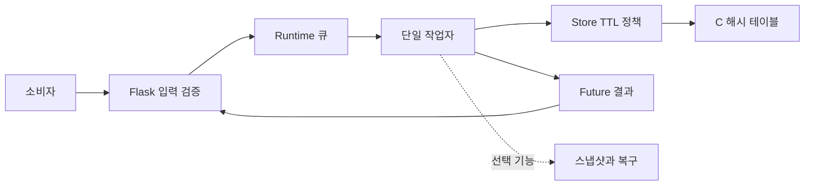

# 캐시 서버 개요

- Python HTTP API가 저장·조회·삭제를 받고, 직접 구현한 C 해시 테이블에 문자열과 TTL을 저장한다.
- 큐와 단일 작업자가 요청·만료 청소를 순서대로 처리해 저장소 접근을 직렬화한다.
- 메모리·TTL·HTTP 연결 뒤 캐시 재사용·명시적 무효화·성능 비교를 먼저 완성하고, 스냅샷·복구는 선택 기능으로 연결한다.

필수 구현 순서는 C 최소 연결 → 메모리 저장·조회·삭제와 HTTP → TTL·청소·동시 요청 검증 → API 응답 캐시 시연(D1·D2) → 캐시 사용·미사용 성능 비교(D3)다. 선택 스냅샷 완료가 시연·측정을 막지 않는다.

동시성은 여러 연결에서 서로 다른 키를 저장한 뒤 성공한 값이 모두 정확히 남는지 확인하고, 실제 C 생성부터 해제까지 접근 스레드가 작업자 하나인지 계측한다. 저장 성공은 메모리 반영이며 디스크 기록 완료를 보장하지 않는다.

| 상세 내용 | 문서 |
| --- | --- |
| 공통 계약·환경·파일 담당·함수별 작업 | [planning](planning.md) |
| C 구조·확장·ctypes·실패와 수명 | [c-hashtable-and-bindings](c-hashtable-and-bindings.md) |
| TTL·문자열·스냅샷 형식과 복구 | [store-and-snapshots](store-and-snapshots.md) |
| HTTP·큐·활성화·OS별 종료 | [http-and-runtime](http-and-runtime.md) |
| 작업별 완료 조건·PR 검토 판단 | [issues](issues.md) |

이 문서는 구현 전 설계의 요약이며 테스트 통과나 지원 완료 기록이 아니다.
