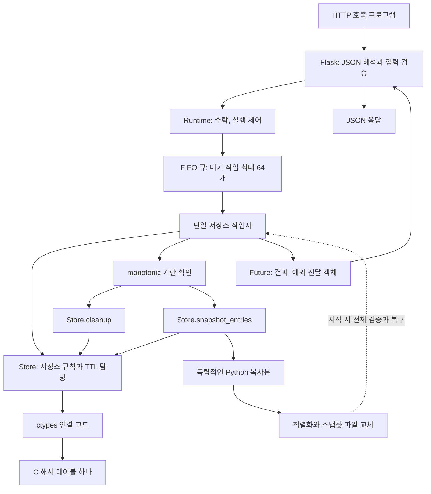

# Planning

[핵심 요약과 호출 흐름](overview.md)

이 문서는 캐시 서버 설계의 공통 계약을 담는다. 구현 상세는 [c-hashtable-and-bindings](c-hashtable-and-bindings.md), [store-and-snapshots](store-and-snapshots.md), [http-and-runtime](http-and-runtime.md)으로 나눈다. 공통 입력, 역할, 환경, 파일 책임과 통합 기준은 이 문서를, 구현별 상세 호출 명세와 시험 사례는 각 구현 문서를 따른다.

## 1. 개요

이 프로젝트는 문자열 키와 값을 저장하는 작은 캐시 서버를 직접 구현하는 학습 프로젝트다. Python을 중심으로 만들고, 해시 테이블은 C로 직접 구현한다. Python은 `ctypes`로 C 공유 라이브러리를 호출한다. 외부에서는 로컬 Flask 개발 서버의 HTTP API로 저장, 조회, 삭제를 요청한다.

Flask 요청 처리 코드는 작업을 큐에 제출하고 결과를 기다린다. 저장소 작업자 하나만 Python 저장소와 C 테이블에 접근하며, 요청, 만료 항목 청소, 스냅샷 저장을 순서대로 실행한다. 같은 서버 인스턴스의 요청은 같은 저장소 상태를 사용한다.

저장할 때 TTL을 선택할 수 있다. 만료 여부는 접근할 때 확인하고, 주기적으로도 만료 항목을 정리한다. 데이터는 스냅샷으로 저장하고 시작 시 복구한다. 저장이나 삭제의 성공 응답은 메모리에 반영됐다는 뜻이며, 디스크 기록 완료를 보장하지 않는다.

## 2. 구현 범위

- C 해시 테이블의 저장, 조회, 삭제, 충돌 처리, 자동 확장과 할당 실패 시 상태 보존.
- Python 저장소의 TTL 갱신, 만료 판정과 주기적 청소.
- HTTP 입력, 응답 변환, 큐를 통한 단일 작업자 실행과 시작, 종료 처리.
- 스냅샷 저장, 파일 교체, 시작 시 검증과 절대 만료 시각 복구.
- 캐시를 사용하는 시연용 호출 프로그램, 원본 API 변경 후 명시적 무효화, 캐시 사용, 미사용 성능 비교.
- 정상 동작뿐 아니라 입력 오류, 경계 시각, 할당, 파일 실패와 동시 요청을 확인하는 자동 테스트.

### 제외 범위

- Redis 프로토콜 호환, 별도 TCP 서버, 명령 파서. 외부 호출은 확정된 HTTP API를 사용한다.
- 키 목록, 배치 처리, 수동 스냅샷 HTTP API 등 선택하지 않은 추가 API.
- 여러 저장소 작업자의 병렬 상태 변경, 다중 프로세스 저장소, 같은 스냅샷 경로의 다중 작성자 지원.
- 별도 청소 작업자나 파일 기록 작업자, 자동 축출, 자동 축소, 증분 청소와 변경 로그.
- 백업 세대, 체크섬, 손상 스냅샷의 자동 복구나 빈 저장소로의 자동 우회.
- 저장 성공 시 디스크 기록 보장, 최대 60초 같은 유실 시간 상한, 시스템 시계 변경과 무관한 TTL 보장.
- 자동 요청 재시도, 연결 단절에 따른 수락 작업 취소, 서버 측 결과 대기 시간 제한과 정상 종료 대기 상한.
- 외부망 공개나 운영용 서버 구성. HTTP 본문과 키, 값에 새 고정 크기 상한을 추가하지 않으며, 메모리 고갈 방어가 필요한 공개 서비스로 취급하지 않는다.
- Docker, 별도 DB나 브로커, CFFI, CPython 확장 타입과 추가 네트워크 프레임워크.
- 해시 테이블 이외 경로의 선제적 C 최적화. 해시 테이블과 djb2는 C로 구현한다. 다른 경로의 최적화는 측정으로 병목이 확인된 경우에만 검토한다.

### 유지해야 할 한계

전체 청소와 동기 스냅샷 중에는 다른 저장소 연산이 기다린다. 큐 용량 64는 서버 전체 메모리나 HTTP 스레드 수의 상한이 아니다. 수락된 요청은 응답이 끊겨도 실행될 수 있으며, 자동 재시도로 실행 여부의 불확실성을 숨기지 않는다.

스냅샷 이후 변경은 재시작 시 유실될 수 있고, 삭제했던 키가 돌아올 수도 있다. 파일의 원자적 교체와 `fsync`만으로 전원 장애 내구성 전체를 보장하지 않는다.

## 3. 기술 설계

HTTP, 실행 제어, 저장소, C 연결, 해시 테이블과 파일 처리의 책임을 나눈다. 아래 구성 요소는 책임의 구분이며 각각이 반드시 별도 파일인 것은 아니다.

### 3.1. 호출 흐름과 상태 소유자

#### 다이어그램을 읽기 위한 용어

| 용어 | 이 프로젝트에서의 뜻 | 위치 또는 구현 도구 |
| --- | --- | --- |
| Store, 저장소 규칙 담당 | 저장, 조회, 삭제, TTL 계산과 만료 판단을 처리하는 Python 클래스. 실제 키, 값, 만료 정보는 C 테이블에 보관 | `store.py`의 `Store` |
| Runtime, 실행 관리자 | 큐, 작업자, 실행 상태와 시작, 종료, 반복 기한을 관리하는 Python 클래스 | `runtime.py`의 `Runtime` |
| 작업자, worker | 큐에서 작업을 꺼내 Store를 호출하는 전용 스레드 하나. Store 자체가 스레드인 것은 아님 | Runtime이 실행하는 비daemon 스레드 |
| Future, 결과 전달 객체 | 작업별 결과 또는 예외가 나중에 채워지는 객체. 작업자가 완료하면 HTTP 요청 함수가 `result()`로 받음. Future가 작업을 실행하지는 않음 | 표준 `concurrent.futures.Future` |
| 준비 Future | 시작 시 복구가 끝났는지, 실패했는지를 실행 관리자에게 알리는 별도 Future. 요청마다 만드는 Future와 구별 | Runtime 내부 |
| FIFO 큐 | 먼저 수락한 작업을 먼저 꺼내는 대기열. 네트워크 도착 순서가 아니라 큐에 들어간 순서 기준 | 표준 `queue.Queue` |
| Event, 종료 신호 | 다른 실행 흐름에 종료 요청을 알리는 표준 스레드 객체. 작업 결과를 담는 Future와 다름 | 표준 `threading.Event` |
| HashTable, C 연결 클래스 | C 테이블을 생성, 조회, 변경, 해제하고 바이트 복사와 C 오류 변환을 담당하는 Python 클래스 | `hashtable.py`의 `HashTable` |
| ctypes | Python에서 DLL/so의 C 함수를 호출하는 표준 라이브러리. 자체 저장소나 서버가 아님 | Python 표준 라이브러리 |
| epoch와 monotonic | epoch는 항목의 절대 만료 시각, monotonic은 청소, 저장의 반복 간격을 판단하는 시계 | `time.time()`, `time.monotonic()` |
| 스냅샷 | 한 판정 시각에 유효한 항목을 독립 복사해 기록한 파일. C 노드나 버킷 주소를 기록하는 것이 아님 | `snapshot.py`, `snapshot.json` |

예를 들어 조회 한 번은 HTTP 입력 검증 → `Runtime.submit("get", key="k")` → 큐 → 작업자 → `Store.get("k")` → HashTable 순서로 진행한다. 작업자가 Future에 문자열 또는 None을 채우면 HTTP 요청 함수의 대기가 끝나고 JSON으로 변환한다. 큐에 넣는 코드와 Store를 실행하는 코드는 서로 다른 스레드에서 동작한다.



| 구성 요소 | 맡는 일과 보유하는 상태 | 하지 않는 일 |
| --- | --- | --- |
| HTTP 처리 | JSON 해석, 허용 필드 검사, 입력 검증, 작업 제출과 Future 결과 대기, 결과와 오류의 HTTP 변환 | Store나 C 테이블 직접 접근, 저장소 상태 보유 |
| 실행 제어와 작업자 | 상태, 큐, 준비 Future, 종료 Event, 주기 기한 관리. 작업자 하나가 테이블을 생성, 복구, 사용, 해제 | 신호 처리기에서 디스크 기록, 다른 스레드의 테이블 접근 허용 |
| Store | 검증된 입력의 연산별 판정 시각, TTL 계산과 만료 처리, 내부 결과 반환 | 외부 입력 재검증, HTTP 코드나 JSON 응답 생성 |
| ctypes 연결 | C 핸들과 임시 복사 버퍼 관리, 타입 선언, 오류 변환, 닫힘 검사 | 연결 코드 밖으로 포인터 노출, 자체 TTL 정책 결정 |
| C 해시 테이블 | 노드, 문자열 복사본, 버킷 배열, 물리 항목 수 보유. 탐색, 삽입, 제거와 cutoff 보조 연산 | 현재 시각 읽기, HTTP 처리, 스케줄링 |
| 스냅샷 파일 처리 | 독립 복사본의 직렬화와 파일 기록, 파일 전체 검증과 복구 데이터 준비 | 살아 있는 C 노드 직접 변경, 별도 기록 작업자 실행 |

Flask 요청 스레드는 여러 개일 수 있지만 Store와 C 테이블의 접근자는 하나다. 한 저장소 연산이 끝나기 전에 다른 요청이나 주기 작업을 끼워 넣지 않는다. GIL은 이 보장의 근거가 아니다.

### 3.2. 입력, 결과와 공개 호출 계약

#### 데이터와 TTL 규칙

- 키와 값은 문자열이다. 빈 키와 빈 값도 허용하며, 공백 제거, 대소문자 변경, 자동 문자열 변환을 하지 않는다.
- 내부 NUL, 한글, 보충 문자와 단독 surrogate를 보존한다. C 경계에서는 UTF-8/surrogatepass로 인코딩하고 같은 방식으로 복원한다.
- TTL은 불리언을 제외한 정수 초 `1~2,147,483,647`이다. `0`, 음수, 범위 초과, 실수, 문자열, 불리언, 명시적 `None` 또는 JSON `null`은 입력 오류다.
- TTL 생략만 무기한이다. 매 저장은 값과 수명을 함께 교체한다. TTL을 지정하면 새 만료 시각을 계산하고, 생략하면 기존 TTL을 제거한다.
- 외부 요청의 입력 검증은 HTTP에서 큐 제출 전에 한 번 수행한다. Store와 Runtime은 검증된 불변 입력만 받는다. 잘못된 요청이면 시각을 읽거나 이미 만료된 물리 항목을 정리하지 않는다. 스냅샷 파일은 별도의 신뢰 경계이므로 읽을 때 전체 검증한다.
- 저장 성공은 `True`, 조회는 문자열 또는 `None`, 삭제는 유효한 키를 제거했으면 `True`, 없거나 만료됐으면 `False`다. 빈 문자열과 키 없음을 구별한다.
- HTTP 입력 오류만 `400/invalid_input`으로 바꾸고, 할당, 표현 불가는 `MemoryError`로 전달한다. 내부 오류를 입력 오류나 `None`, `False`로 숨기지 않는다.

#### Python 내부 호출 계약

아래는 구현 코드가 아니라 검증된 입력을 받는 내부 호출 명세다. HTTP는 필수 필드 존재 여부와 명시적 `ttl:null`을 먼저 검사하고, TTL 생략만 내부 `None`으로 전달한다. 별도 생략 센티널은 두지 않는다.

```text
Store.set(key: str, value: str, *, ttl: int | None = None) -> bool
Store.get(key: str) -> str | None
Store.delete(key: str) -> bool
Store.cleanup() -> None
Store.snapshot_entries() -> list[tuple[str, str, float | None]]
```

HTTP 요청 함수가 필드, 문자열, TTL을 검사한 뒤 `runtime.submit(...).result()`를 호출한다. 검증 단계의 오류만 400으로 변환하며 제출과 결과 대기는 그 처리 범위 밖에 둔다. 내부 Python 호출의 인자 누락, 개수 초과와 알 수 없는 키워드는 호출 버그의 `TypeError`다.

Store는 생성 시 `clock=time.time`을 받는다. 각 연산은 판정 시각 `t`를 한 번 읽고 재사용한다. 저장은 `E=t+TTL`, 만료 판정은 `t >= E`다. 소수 초를 버리지 않는다. 외부 요청에서 판정 시각을 지정할 수는 없다. 시스템 시각이 전진하거나 후퇴하면 TTL도 영향을 받는 한계를 허용한다.

연산별 호출 순서와 실패 시 상태 보존 규칙은 [store-and-snapshots](store-and-snapshots.md#연산별-호출-순서)을 정본으로 한다. 유효 조회의 복사나 디코딩이 실패해도 원본을 유지하고, 삭제와 만료 정리는 추가 할당 없이 수행하며, 반환 복사본과 순회 결과의 순서는 보장하지 않는다는 경계도 그 문서에 둔다.

### 3.3. C 테이블과 확장

C 노드와 버킷, djb2, 0.75 확장 경계, 덮어쓰기, 재해싱 커밋과 할당 실패 시 상태 보존의 상세 규칙은 [c-hashtable-and-bindings](c-hashtable-and-bindings.md)을 정본으로 한다. 공통 경계는 C가 시계를 읽거나 TTL을 계산하지 않고 Python이 전달한 cutoff만 사용하며, 준비 단계 실패 시 기존 키, 값, TTL, 물리 개수, 버킷 수를 보존한다는 점이다.

### 3.4. ctypes 경계와 메모리 수명

얇은 Python `HashTable` 연결 클래스가 C 공유 라이브러리를 감싼다. Windows에서는 `_hashtable.dll`, Linux에서는 `_hashtable.so`를 연결 코드 파일 위치 기준 절대 경로로 `ctypes.CDLL`에 전달한다. 별도 프로세스나 CPython 확장 타입을 만들지 않는다. C 함수 원형, 출력 구조체, 상태 코드, ctypes 대응, 복사와 해제 규칙은 [c-hashtable-and-bindings](c-hashtable-and-bindings.md)을 정본으로 한다.

### 3.5. 큐와 오류 전달

대기 큐는 표준 `queue.Queue(maxsize=64)`이며 실행 중 작업 하나는 별도다. 제출은 짧은 상태 잠금 안에서 RUNNING 확인과 `put_nowait`를 함께 수행한다. 가득 차면 수락하지 않고 `BusyError`를 전달한다. 같은 잠금으로 C 연산을 실행하지 않는다. 작업 항목, Future 완료, 포화와 이용 불가 거부, 작업자 실패 전환의 상세 규칙은 [http-and-runtime](http-and-runtime.md)을 정본으로 한다.

### 3.6. HTTP 계약

세 연산은 모두 POST와 JSON 객체 본문을 사용한다. 빈 키, NUL, 슬래시를 URL 경로 인코딩으로 전달하지 않는다. `/set`, `/get`, `/delete`의 성공 응답, 400, 415, 404, 405, 503, 500 오류 코드, JSON 파싱과 내부 예외의 구분, `MAX_CONTENT_LENGTH=None` 같은 상세 계약은 [http-and-runtime](http-and-runtime.md)을 정본으로 한다.

### 3.7. 시작, 주기 작업과 종료

상태는 `STARTING → RUNNING → STOPPING → STOPPED`, 실패 경로는 `FAILED`다. 준비 완료와 활성화는 다르다. 컨트롤러는 Runtime 생성, 시작, 준비 대기로 테이블 생성과 복구를 끝낸 뒤 Runtime을 주입한 Flask 앱을 만들고, 서버 소켓을 수신 루프 없이 바인드한다. 바인드가 성공한 뒤에만 Runtime을 활성화해 RUNNING으로 전환하고 monotonic 기한을 처음 잡은 뒤 수신 루프를 실행한다.

```text
Runtime 생성 → Runtime.start → Runtime.wait_ready
→ create_app(runtime) → make_server(바인드만)
→ Runtime.activate → RUNNING, 기한 초기화 → 별도 서버 스레드의 serve_forever
```

- 복구 완료 후에도 활성화 전 Runtime은 STARTING이다. submit은 수락하지 않고, 청소, 스냅샷, 최종 스냅샷을 실행하지 않는다. 준비된 메모리는 다시 만들 수 있지만 다른 코드가 C 테이블에 접근하지는 않는다.
- 활성화 시점에 `monotonic`을 한 번 읽어 첫 청소 기한을 +1초, 첫 스냅샷 기한을 +60초로 잡는다. 이후 다음 청소 기한은 청소 완료 후 1초, 다음 스냅샷 기한은 저장 시도 완료 후 60초다.
- 바인드 실패는 새 데이터 변경 없이 `request_stop(final_snapshot=False)`와 join으로 정리하고 종료 코드 1을 반환한다. 이전 정식 파일을 보존하고 작업자 안에서 C 자원을 해제한다.
- 메인 스레드 컨트롤러만 시작, 활성화, 종료를 순서대로 한 번씩 호출한다. 신호 처리기는 Event만 알리며 컨트롤러가 수신 전 종료 여부를 확인한다. 수명 API의 재시작이나 임의 호출 순서는 지원하지 않는다.
- 정상 종료는 새 제출 차단, 수신 중단, 수락 작업 완료, 최종 스냅샷 한 번, C 자원 해제, 작업자 join 순서다. FAILED에서는 최종 저장을 생략한다. 복구, 바인드, 활성화, 작업자 실패와 최종 저장 실패는 종료 코드 1이다.

시작과 활성화 의존성의 상세 계약과 R4 시험은 [http-and-runtime](http-and-runtime.md#시작과-활성화-의존성)을 정본으로 한다. R4는 복구 완료 후 바인드와 활성화를 60초 넘게 지연해도 주기 기록과 청소가 없고, 첫 기한이 활성화 시점부터 계산되는지 확인한다.

### 3.8. 스냅샷 저장과 복구

정식 파일은 데이터 디렉터리의 `snapshot.json`이며 버전 1 형식, Base64 키와 값, 절대 만료 시각, 임시 파일 기록과 `flush`, `fsync`, `os.replace` 순서, 시작 시 전체 검증과 준비용 테이블 복구 규칙은 [store-and-snapshots](store-and-snapshots.md)을 정본으로 한다. 공통 경계는 스냅샷 이후 변경이 유실될 수 있고, 손상 파일을 자동으로 덮어쓰거나 임시 파일을 복구 후보로 승격하지 않는다는 점이다.

### 3.9. 실행 환경

| 항목 | 채택한 방침 |
| --- | --- |
| Python | CPython 3.12, 일반 GIL 빌드, 64비트, 프로젝트별 `venv` |
| 패키지 범위 | Flask `3.1.*`, Werkzeug `3.1.*`, pytest `8.3.*`, setuptools `75.*`, wheel `0.45.*` |
| 설치 선언 | Python 의존성은 프로젝트 메타데이터, 테스트 도구는 `test` extra. 패키지 설치와 C 컴파일은 별도 |
| C 빌드 | C11 공유 라이브러리와 일반 C ABI. Python 개발 헤더 불필요. 바이너리 공유 대신 소스로 각자 빌드 |
| Windows 방침 | x64 Python, Visual Studio 2022 Build Tools의 C++ 빌드 도구와 Windows SDK, x64 개발자 PowerShell에서 MSVC |
| Linux 방침 | x86-64 Python 3.12, GCC와 기본 빌드 도구. macOS는 공통 검증 대상에서 제외 |
| 서버 | `127.0.0.1:5000`, debug와 reloader 끔. `werkzeug.serving.make_server(..., threaded=True)`로 종료 핸들 확보 |
| 실행 방식 | 구현 저장소에서 `python -m mini_redis --data-dir ...`. `flask run`과 다중 프로세스는 사용하지 않음 |
| 데이터 경로 | 실행마다 필수 지정, 시작 시 절대화. 서로 다른 서버와 테스트가 같은 디렉터리를 사용하지 않음 |

팀이 실제 사용할 환경 하나에서 깨끗한 설치와 최소 C 연결을 검증한 뒤 Python 패치 버전, 패키지 정확 버전, OS와 컴파일러 버전을 기록한다. 패키지 버전 범위만으로 정확 버전 잠금을 대신하지 않는다. Windows와 Linux는 각각 컴파일과 파일 교체를 검증해야 하며, 방침을 적은 것만으로 두 OS 모두 지원 완료로 보지 않는다.

## 4. 테스트와 기대 결과

아래는 구현이 만족해야 할 입력, 실행 순서와 기대 결과다. 실제 테스트 통과 기록은 아니다. 별도 설명이 없으면 각 사례는 빈 저장소와 독립된 임시 데이터 디렉터리에서 시작한다. `t`는 테스트가 제어하는 epoch 시각, `E`는 절대 만료 시각이다.

### 4.1. 검증 경계와 준비

| 검증 경계 | 확인할 사례와 방법 |
| --- | --- |
| Store | T1~T12, T15~T16, T18, S-T5, S-T7, S-T12. 가짜 epoch 시계로 경계 시각과 갱신, 청소 순서, 오류 직후 물리 상태 확인 |
| C와 연결 코드 | T17, T19, T20, S-T2~S-T4, S-T13. 실제 충돌 키, 재해싱, 할당 지점별 실패, 길이, NUL, 한글, 보충 문자와 단독 surrogate 왕복, 값, TTL, 물리 개수, 버킷 수 보존 |
| HTTP 변환 | T1~T14, T21의 매핑. Flask test client와 Runtime 대체 객체로 상태, JSON, 전달 입력, 호출 횟수 확인 |
| 실행 연결 | S-T1, S-T11, S-T14. 실제 작업자와 여러 HTTP 연결, 포화, 종료 경쟁, 실패 Future 해제와 접근 스레드 ID 확인 |
| 파일과 복구 | S-T6~S-T10, S-T13. 임시 디렉터리, 기록 단계별 실패, 별도 프로세스 중단, 재시작 |
| 공통 환경 | 깨끗한 설치, C 빌드와 ABI 대조, 전체 pytest, 서버 시작, Ctrl+C, 재시작, 대상 OS의 교체, 중단 동작 |

Store에는 epoch 시계, 작업자 스케줄러에는 monotonic 시계를 주입한다. 주기 시험을 위해 실제 1초, 60초를 기다리지 않는다. 실제 스레드와 프로세스 연결은 별도 통합 테스트로 검증한다.

C 할당 실패 주입과 dump, 시험 빌드 전환, 파일 실패 monkeypatch, 큐 포화 준비, Runtime 대체 객체의 세부 절차는 각 구현 문서와 5.3절 테스트 파일을 정본으로 한다. 공통 제약은 실패 주입이 라이브러리 전역이므로 관련 시험을 병렬 실행하지 않고, 시험 훅이 없을 때 관련 시험을 조용히 건너뛰지 않으며, 별도 저장 엔진을 만들지 않고, 대체 객체 통과를 실제 C, 작업자 통합 통과로 표시하지 않는다는 점이다.

### 4.2. 테스트 색인

개별 입력과 기대 결과는 각 구현 문서에 둔다. 아래 색인은 62개 사례 ID의 상세 정의 위치와 확인 경계를 나타낸다. 상세 정의는 한곳에 두지만 같은 사례를 단위 시험과 실제 연결 시험에서 함께 확인할 수 있다. 테스트 파일별 확인 범위는 5.3절을 따른다.

| 구현 문서 | 사례 ID | 단위 확인 | 통합 확인 | 함께 확인할 담당 |
| --- | --- | --- | --- | --- |
| [store-and-snapshots](store-and-snapshots.md) | T1~T12, T15~T16, T18, S-T5~S-T10, S-T13, D1~D2 (24개) | T1~T12, T15~T16, T18, S-T5~S-T10, S-T13의 Store와 파일 경계 | S-T6~S-T10, S-T13, D1~D2의 실제 연결 | 2 주 담당, 1 C 상태 보존, 3 파일과 종료 연결 |
| [c-hashtable-and-bindings](c-hashtable-and-bindings.md) | T17, T19, T20, S-T2~S-T4, B1~B6, D3 (13개) | T17, T19, T20, S-T2~S-T4, B1~B6의 C와 연결 경계 | S-T4의 파일 왕복, D3의 실제 HTTP 측정 | 1 주 담당, 2 값과 TTL 보존, 3 실행 연결 |
| [http-and-runtime](http-and-runtime.md) | T13, T14, T21, S-T1, S-T11, S-T12, S-T14, H1~H12, R1~R6 (25개) | T13, T14, T21, S-T11, S-T12, H1~H12, R1~R3, R6 | S-T1, S-T14, R4~R5 | 3 주 담당, 1 소유권과 C 실패, 2 입력과 파일 |

## 5. 파일 구성

### 5.1. HTTP 제출과 작업자 실행 분리

HTTP 요청 함수는 `mini_redis/http.py`, 작업자 실행 제어는 `mini_redis/runtime.py`에 둔다. 아래 경로는 구현 저장소 루트 기준이다.

```text
HTTP 입력 검증 → runtime.submit → 큐 → 단일 작업자 → Store
HTTP 응답 변환 ← Future.result() ← 단일 작업자
```

- HTTP는 외부 입력을 한 번 검증하고 작업 제출과 Future 결과 대기를 수행한다. Store나 C 테이블에 직접 접근하지 않는다.
- runtime만 큐, 실행 상태, 상태 잠금, 준비 Future, 종료 Event와 주기 기한을 소유한다. HTTP는 이 상태를 복제하거나 별도 잠금을 만들지 않는다.
- `__main__.py`는 runtime을 만든 뒤 `create_app(runtime)`에 전달한다. runtime은 http를 import하지 않는다.
- `contracts.py`에는 공유 타입과 예외만 둔다. 요청 검증은 http 안에 두고 Store에서 반복하지 않는다.

수락, 종료, 실패의 상태 전환은 runtime 한곳에서 관리한다. 내부 제출, 수락과 종료의 원자성, 활성화 경계는 [http-and-runtime](http-and-runtime.md#시작과-활성화-의존성)을 정본으로 한다.

### 5.2. 구현 파일과 책임

| 파일 | 구현할 내용과 분리 이유 |
| --- | --- |
| `src/hashtable.h` | C 함수 원형, 출력 구조체, 오류 코드와 함수 내보내기. C 구현과 ctypes가 맞춰야 할 경계를 한곳에 고정 |
| `src/hashtable.c` | djb2, 노드, 버킷, 탐색, 삽입, 삭제, 확장, 독립 복사와 해제, 시험 전용 할당 실패와 dump. TTL 시계나 HTTP 정책은 넣지 않음 |
| `mini_redis/__init__.py` | Python 패키지 인식. import 시 서버나 작업자를 시작하거나 C 테이블을 생성하지 않음 |
| `mini_redis/contracts.py` | `Operation`, `Entry` 타입 별칭과 공유 예외 정의. 실행 모듈을 import하지 않음 |
| `mini_redis/hashtable.py` | DLL/so 로딩, ctypes 선언, `HashTable` 메서드, C 오류 변환과 포인터 수명, 닫힘 검사. C 주소를 이 파일 밖으로 노출하지 않음 |
| `mini_redis/store.py` | Store 내부 메서드, 문자열 변환, 연산 시각과 TTL 정책. HTTP, 큐와 무관하게 저장소 동작 시험 가능 |
| `mini_redis/snapshot.py` | JSON/Base64 검증과 변환, 임시 파일 기록, 교체와 파일 읽기. 독립 데이터만 취급하고 살아 있는 C 테이블을 받지 않음 |
| `mini_redis/http.py` | Flask 앱과 세 경로, JSON 입력과 HTTP 오류, 결과 변환. Runtime을 주입받아 입력 검증, 제출과 Future 결과 대기 수행. 단위 시험은 Runtime 대체 객체 사용 |
| `mini_redis/runtime.py` | 내부 작업 제출, 큐, 상태, 작업자, 복구 데이터의 준비용 테이블 삽입과 게시, 활성화, 주기 기한, Future, 실패, 종료 처리 |
| `mini_redis/__main__.py` | `--data-dir` 해석, 경로 고정, 서버와 작업자 준비, 수신, 종료 조정, 신호 Event와 종료 코드. 큐 수락, TTL, 파일 형식 규칙은 재구현하지 않음 |
| `pyproject.toml` | 패키지 설치 메타데이터, 의존성 범위와 `test` extra. pip 설치가 C 컴파일도 수행한다고 가정하지 않음 |
| `.gitignore` | 가상환경, Python 캐시, 로컬 DLL/so, C 빌드 산출물과 실행 데이터 제외. 바이너리와 실제 스냅샷을 소스로 공유하지 않음 |
| `README.md` | 설치, C 빌드, 시험 빌드 전환, 실행, 종료, 테스트, 시연, 측정 명령과 실제 검증한 환경 버전 기록 |
| `demo/origin.py` | 결과를 바꾸고 호출 횟수를 확인할 작은 로컬 원본 API. 원본 서비스 역할을 캐시 서버와 구분 |
| `demo/client.py` | 원본 응답 저장, 재사용, 원본 변경 후 명시적 삭제 흐름. 캐시 소비자 역할이며 자동 재시도하지 않음 |
| `demo/benchmark.py` | 같은 원본 작업의 캐시 사용, 미사용 비교와 측정 조건, 응답 시간, 원본 호출 횟수 기록 |

Store의 내부 시그니처는 3.2절을 따른다. C 연결 코드는 HTTP나 실행 제어를 import하지 않는다.

복구에서 `snapshot.py`는 파일 전체를 검증해 독립 데이터를 반환한다. runtime의 작업자가 복구 시각을 한 번 읽고 준비용 테이블에 원래 만료 시각으로 삽입한 뒤 Store를 게시한다. 저장에서는 작업자가 `Store.snapshot_entries()`의 독립 복사본을 `snapshot.py`에 전달한다. 파일 분리로 C 테이블 접근 권한을 파일 처리 코드에 넘기지 않는다.

### 5.3. 테스트 파일과 확인 범위

각 테스트 파일은 별도 상태와 임시 경로를 사용한다. 같은 사례가 여러 경계에 걸치면 단위 시험과 실제 연결 시험에서 함께 확인한다.

| 파일 | 확인할 범위 |
| --- | --- |
| `tests/conftest.py` | 가짜 epoch, monotonic 시계, 임시 데이터 경로, 작업자 정리와 공통 테스트 준비. 다른 저장 엔진은 구현하지 않음 |
| `tests/test_contracts.py` | 공통 타입, 예외 상속과 뼈대의 import, 시그니처 검사 |
| `tests/test_hashtable.py` | T17, T19, T20, S-T2~S-T4, S-T13, B1~B6. 충돌, 확장, 할당 실패, 복사 수명, 닫힘 이후 접근, ABI |
| `tests/abi_probe.c` | C 헤더의 `sizeof`와 `offsetof`를 출력하는 시험용 프로그램. B2에서 ctypes 결과와 대조하며 운영 라이브러리 API는 늘리지 않음 |
| `tests/test_store.py` | T1~T12, T15~T20의 저장소 결과와 상태 변화, 소수 초, 만료 경계와 갱신, 청소 순서. 물리 상태는 시험 훅으로 관찰 |
| `tests/test_snapshot.py` | S-T6~S-T10, S-T13의 파일 변환, 기록 실패, 형식 검증. 정지, 재시작 없는 파일 단위 시험 |
| `tests/test_http.py` | T13, T14, T21, H1~H12. Runtime 대체 객체로 입력 검증, 요청, 응답, Future 예외와 미제출 확인 |
| `tests/test_runtime.py` | S-T11, S-T12, S-T14, R1~R6. 기한, FIFO, 포화, Future, 소유권과 종료 경쟁 |
| `tests/test_integration_c.py` | S-T4와 실제 C 실패·복사 수명의 Store 연결. 담당 1 |
| `tests/test_integration_store.py` | S-T6~S-T10, S-T13, D1, D2. 파일, 복구, 무효화와 실제 시연 연결. 담당 2 |
| `tests/test_integration_runtime.py` | S-T1, S-T11~S-T12, S-T14, R4, R5. 실제 HTTP, 작업자, 종료와 접근 소유권. 담당 3 |

`_hashtable.dll` 또는 `_hashtable.so`는 `mini_redis/`에 생성하는 로컬 빌드 산출물이며 직접 작성할 소스 파일이 아니다. `snapshot.json`과 임시 파일은 지정한 데이터 디렉터리에 생성하고 소스 관리에서 제외한다.

### 5.4. 함수 뼈대를 위한 호출 명세

파일 이름만 만드는 것으로 끝내지 않고 아래 이름, 생성자, 인자, 반환과 예외 경계를 먼저 맞춘다. 이 절은 함수 선언 명세이며 실제 처리 코드가 아니다. 파일 내부에서만 사용하는 탐색, 직렬화, 스케줄링 보조 함수는 구현자가 나눌 수 있지만, 파일 사이에 새 호출을 추가하면 이 명세와 양쪽 호출부, 시험도 함께 맞춘다.

#### 공통 타입과 예외: `contracts.py`

| 이름 | 정의 또는 호출 명세 | 의미 |
| --- | --- | --- |
| `Operation` | `Literal["set", "get", "delete"]` 타입 별칭 | 큐에 제출할 연산 이름. 명령 파서를 추가하는 것이 아님 |
| `Entry` | `tuple[str, str, float \| None]` 타입 별칭 | 키, 값, 절대 만료 시각. 새 항목 클래스나 직렬화 계층을 만들지 않음 |
| `BusyError` | `RuntimeError`의 하위 예외 | 포화로 수락하지 않은 작업 |
| `UnavailableError` | `RuntimeError`의 하위 예외 | RUNNING이 아니어서 수락하지 않은 작업 |
| `WorkerFailedError` | `UnavailableError`의 하위 예외 | FAILED에서 현재, 대기 작업을 완료할 때 전달. 미실행을 뜻하지는 않음 |

HTTP는 JSON 파싱과 입력 검증만 400 변환 범위에 둔다. Runtime 제출과 Future 결과의 내부 예외는 별도로 처리한다. Store 입력 재검증과 별도 생략 센티널은 두지 않는다.

#### 구현별 호출 명세

- C 연결과 C 함수 원형, 구조체, 상태 코드, `HashTable` 메서드, 시험 훅은 [c-hashtable-and-bindings](c-hashtable-and-bindings.md)을 따른다.
- Store 생성자와 메서드, 연산별 호출 순서는 [store-and-snapshots](store-and-snapshots.md)을 따른다.
- `read_snapshot`, `write_snapshot`과 파일 데이터 경계는 [store-and-snapshots](store-and-snapshots.md)을 따른다.
- Runtime 생성, `start`, `wait_ready`, `activate`, `submit`, `request_stop`, `join`, `state`는 [http-and-runtime](http-and-runtime.md#시작과-활성화-의존성)을 따른다.
- `create_app(runtime)`과 세 요청 함수는 [http-and-runtime](http-and-runtime.md)을 따른다.
- `demo/origin.py`, `demo/client.py`, `demo/benchmark.py`의 함수 명세는 각 구현 문서에 둔다.

#### 공통 구현 제약

- `mini_redis/__init__.py`: 함수나 재내보내기를 추가하지 않고 빈 패키지 진입 파일로 둔다.
- `tests/abi_probe.c`: `int main(void)`로 C 크기와 오프셋 출력. 운영 라이브러리에는 ABI 조회용 함수를 추가하지 않는다.
- `tests/test_*.py`: 4절의 사례를 해당 5.3절 파일에 `test_...` 함수 또는 매개변수화 사례로 배치한다. 함수 이름에 번호를 포함해 사례를 찾을 수 있게 한다. conftest fixture는 실제 공유하는 것만 만들고 별도 엔진을 구현하지 않는다.
- 시연과 측정은 D1~D3을 실제 HTTP로 확인하며 원본과 캐시 프로세스 사이에 Python 객체를 공유하지 않는다.

### 5.5. 첫 작업: 함수 뼈대 만들기

1. 5.2, 5.3절의 파일을 만들고 5.4절의 클래스, 생성자, 함수, 공통 타입과 예외, `Runtime.activate`, C 구현 문서의 C 선언과 구조체 자리를 만든다. Python 표준 타입은 `pathlib.Path`, `typing.Callable/Sequence/Literal`, `concurrent.futures.Future`를 사용한다.
2. Python import 의존성을 연결한다. contracts는 실행 모듈을 import하지 않고, runtime은 http를 import하지 않는다. 타입 힌트만 필요한 import는 TYPE_CHECKING과 지연 어노테이션으로 순환 import를 막는다. Store나 HTTP가 다른 저장 엔진을 대신 만들지 않는다.
3. Python 미구현 동작은 `NotImplementedError`로 분명히 중단한다. 저장, 삭제 성공 True, 조회 None, 빈 복구 리스트를 임시 성공값으로 반환하지 않는다. 정상 객체를 만드는 생성자, 컨테이너 정의와 실제 처리 본문을 구별한다.
4. 모듈 import로 DLL 로딩, 파일 생성, 스레드, 서버 시작이 일어나지 않게 한다. C 구현은 헤더와 함수 정의 자리를 맞춘다. int 반환 미구현 함수는 뼈대 전용 HT_UNIMPLEMENTED=5를 반환하고 출력은 빈 상태로 둔다. 연결 코드는 이를 NotImplementedError로 변환한다. void 반환 미구현 함수는 abort()로 중단하며 해제 성공을 가장하지 않는다. 구현 완료 뒤 임시 상태 코드는 제거한다. 처음에는 C 컴파일과 서버 실행 성공을 요구하지 않는다.
5. `tests/test_contracts.py`에 뼈대용 import, 시그니처 검사를 둔다. 실제 venv가 없으면 Python AST로 선언을 정적으로 점검한다. AST 검사는 import, 실행 검증을 대신하지 않으며 수행한 범위를 구별한다.
6. 작업자나 서버를 실행하지 않고 파일 경로, 함수 이름과 인자 기본값, 예외 이름과 상속, `Runtime.activate`를 포함한 공개 경계, C 헤더와 ctypes 구조체 대응을 서로 확인한다. 뼈대 합의가 끝나면 담당별 기능과 테스트 본문을 채운다.

뼈대 완료는 정상 동작 완료가 아니다. 최초 제출에서는 선언, 의존 관계와 미구현 중단 여부를 확인하고, 기능별 이슈는 4절의 실제 기대 결과를 만족해야 닫는다.

## 6. 3인 분담

아래 배치로 작업을 분담한다. 담당 1, 2, 3은 실제 이름 대신 사용하는 역할 표시다. 코드 작성 담당과 실행 중 상태 소유자는 다르다. 누가 코드를 작성하든 C 테이블 접근은 단일 저장소 작업자만 수행한다.

### 6.1. 담당 범위

| 담당 | 구현 책임 | 직접 작성할 테스트 | 상대에게 제공할 결과 |
| --- | --- | --- | --- |
| 담당 1. C 테이블과 Python 연결 | C 헤더, 해시 테이블, ctypes 연결과 메모리 수명, C 빌드, 원본 API와 성능 비교 도구 | 충돌, 확장, 할당 실패, C/ctypes ABI, 복사, 해제, 측정 도구의 요청과 원본 호출 집계 | Store가 사용할 `HashTable`, 시험 훅과 ABI 확인 프로그램, 로컬 빌드 방법, 원본 API와 측정 결과 |
| 담당 2. 저장소 규칙과 파일 | 공통 타입, 예외 계약, Store의 TTL, 청소, 스냅샷 복사, 파일 저장, 검증, 시연 소비자 | 만료 경계, 덮어쓰기, 오류 직후 물리 상태, 문자열 파일 왕복, 파일 단계별 실패, 손상 | 작업자가 사용할 Store와 독립 데이터 기반 파일 함수, 가짜 epoch 시계, 캐시 재사용, 무효화 시연 |
| 담당 3. HTTP와 실행 제어 | HTTP 입력 검증, 큐, 상태, 작업자, 기한, Flask 변환, 서버 시작, 종료와 조립 | HTTP 입력과 결과 변환, 포화, FIFO, 소유권, Future 해제, monotonic 기한, 수락과 종료 경쟁, 신호와 종료 코드 | HTTP 서버 실행 경로, 실제 단일 작업자 연결, 정상, 실패 종료 동작 |

담당 3에게 서버 연결과 통합 실행 경계가 모이므로, 파일, 복구와 소비자 시험까지 모두 맡기지 않는다. 담당 1은 C 연결을 먼저 제공하고 원본, 측정 도구를 붙인다. 담당 2는 공통 계약과 Store를 먼저 제공하고 파일, 시연 소비자를 붙인다. 각 담당자는 자신의 구현이 합쳐지는 구간의 통합 시험을 담당별 파일에 작성한다. 공통 fixture는 conftest의 담당 2, README는 담당 1이 조정하고 수정할 절·fixture 이름을 먼저 나눈다.

### 6.2. 파일별 수정 책임

| 생성할 파일 | 주 담당 | 함께 확인할 담당 |
| --- | --- | --- |
| `src/hashtable.h` | 1 | 2. 값, 만료, 오류, 출력 계약 확인 |
| `src/hashtable.c` | 1 | 2. 실패 시 값, TTL, 물리 상태 보존 확인 |
| `mini_redis/hashtable.py` | 1 | 2. Store 호출 순서와 독립 복사 확인 |
| `tests/test_hashtable.py` | 1 | 2 |
| `tests/abi_probe.c` | 1 | 2 |
| `pyproject.toml` | 1 | 2, 3. 의존성과 설치, 실행 확인 |
| `.gitignore` | 1 | 2, 3. 데이터, 빌드 산출물 제외 확인 |
| `mini_redis/__init__.py` | 1 | 3. import 시 실행 부작용 없음 확인 |
| `demo/origin.py` | 1 | 2. 결과 변경과 호출 횟수 관찰 확인 |
| `demo/benchmark.py` | 1 | 2, 3. 동일 원본 작업, 결과와 측정 조건 확인 |
| `mini_redis/contracts.py` | 2 | 1, 3. 공유 타입, 예외의 모든 호출부 확인 |
| `mini_redis/store.py` | 2 | 1, 3. C 호출과 작업자 전용 접근 확인 |
| `mini_redis/snapshot.py` | 2 | 3. 복구 게시와 종료 저장 연결 확인 |
| `tests/test_contracts.py` | 2 | 3 |
| `tests/test_store.py` | 2 | 1 |
| `tests/test_snapshot.py` | 2 | 3 |
| `demo/client.py` | 2 | 1, 3. 재사용, 명시적 무효화 확인 |
| `mini_redis/runtime.py` | 3 | 1, 2. 접근 소유권, 복구, 실패 시 상태 확인 |
| `mini_redis/http.py` | 3 | 2. 입력, HTTP 변환 확인 |
| `mini_redis/__main__.py` | 3 | 1, 2. 준비, 수신, 신호, 해제 확인 |
| `tests/test_http.py` | 3 | 2 |
| `tests/test_runtime.py` | 3 | 1, 2 |
| `tests/conftest.py` | 2 | 1, 3. C 실패 주입 정리와 작업자 종료 fixture는 각 구현 담당이 제공 |
| `tests/test_integration_c.py` | 1 | 2. C 실패·문자열 연결 확인 |
| `tests/test_integration_store.py` | 2 | 1, 3. 파일·복구·소비자 연결 확인 |
| `tests/test_integration_runtime.py` | 3 | 1, 2. 서버·작업자·종료 연결 확인 |
| `README.md` | 1, 문서 수정 조정 | 2는 데이터, 파일, 소비자, 3은 서버, 종료, 실행 시험 명령 작성과 확인 |

주 담당은 변경을 조정하는 사람이지 해당 파일을 혼자 검증하는 사람이 아니다. 공용 파일은 동시에 수정하기 전에 대상 절이나 fixture를 나누고 변경을 맞춘다. 실제 데이터나 빌드 산출물은 이 목록의 소스 파일과 별도로 생성되며 공유하지 않는다.

### 6.3. 계약 변경 규칙

- 입력, 반환, 예외, C 함수, 구조체, HTTP 상태와 본문, 큐, 수명 규칙을 바꾸면 해당 코드만 수정하지 않는다. 영향을 받는 호출부, 테스트와 README도 같은 변경 단위에 포함한다.
- C 헤더나 수명을 바꾸면 담당 1과 2가 C 구현, ctypes, Store와 ABI 시험을 함께 확인한다. 작업자 접근이나 종료 동작에도 영향이 있으면 담당 3도 확인한다.
- 입력 계약이나 공유 예외를 바꾸면 담당 2와 3이 HTTP, Store를 함께 확인하고, C 연결이 사용하는 예외도 담당 1과 맞춘다.
- 파일 데이터 계약을 바꾸면 담당 2와 3이 파일 전체 검증, 준비용 테이블 복구, 게시 시점과 정상, 실패 종료 시험을 함께 확인한다.
- 상대 구현이 아직 없다고 공개 계약을 임의로 늘리거나 다른 저장 엔진을 만들지 않는다. HTTP 단위 시험에는 정해진 결과를 반환하는 Runtime 대체 객체를 쓴다.

## 7. 구현과 통합 순서

### 7.1. 병렬로 시작할 작업

먼저 전원이 5.4절의 함수 뼈대와 import 경계를 맞춘 뒤 아래 기능 본문을 나눠 작성한다. 뼈대 작성 중에는 실제 C, 서버 실행이 아니라 선언과 모듈 간 연결을 확인한다.

| 담당 | 먼저 만들 작은 단위 | 함께 맞출 경계 |
| --- | --- | --- |
| 1 | C 헤더와 생성, 삽입, 조회, 삭제, 해제, ctypes 선언과 최소 연결 시험 | 2와 바이트, 절대 시각, 오류 변환, 3과 소유 스레드에서 생성, 해제 |
| 2 | 공유 타입, 예외 계약과 Store 메서드, 가짜 epoch 시계, 파일 형식 검증 | 1과 `HashTable` 메서드, 3과 Store 호출, 준비 데이터 복구 |
| 3 | Runtime 대체 객체를 사용하는 HTTP 시험, runtime 제출, 상태, Future 경계와 monotonic 기한 시험 | 2와 입력 계약, 예외, 1, 2와 실제 작업자 조립 |

컴파일러와 가상환경은 각자의 실행 시험에 필요하다. 설치, 빌드가 안 된 상태에서도 HTTP 변환과 파일 형식 같은 독립 단위는 작성할 수 있으나, C 연결과 실제 통합 시험을 통과한 것으로 표시하지 않는다.

### 7.2. 작은 경로부터 합치는 순서

최초 작업은 5.5절의 함수 뼈대다. 선언, 인자, 예외, import 경계를 전원이 확인한 뒤 아래 실제 동작 연결 순서로 진행한다.

| 순서 | 연결할 파일과 기능 | 참여 담당 | 확인할 완료 기준 |
| --- | --- | --- | --- |
| 1. C 최소 연결 | `hashtable.h/c → hashtable.py`, ABI 프로그램 | 1 작성, 2 확인 | B1, B2, 빈 문자열, NUL, 한글 저장, 조회, 삭제, 해제. 시험 훅을 사용할 수 있고 C 오류가 Python 예외로 전달됨 |
| 2. 메모리 동작과 첫 HTTP 연결 | `contracts.py → store.py`, `http.py → runtime.py → Store`, `__main__.py`의 start, wait_ready, activate | 1, 2, 3 | T1~T5, T10, T17, T19, T20, S-T1. 다른 연결에서 저장한 값을 읽고 삭제. 같은 상태와 단일 접근 소유자, 충돌, 확장, 할당 실패 보존 확인. 활성화 전 요청 미수락 |
| 3. TTL, 청소, 작업자 경계 | Store와 C cutoff 연산, runtime 기한, 포화, Future, 종료 상태 | 2, 3 작성, 1은 C 실패, 순회 확인 | T6~T16, T21, S-T5, S-T11, S-T12, S-T14, H1~H12, R1~R3, R6. 새 값을 옛 만료로 지우지 않고 유휴, 폭주에서도 기한 확인 |
| 4. 시연 소비자 | `demo/origin.py → demo/client.py → HTTP 서버` | 1, 2 작성, 3 연결 확인 | D1, D2. 재사용 시 원본 호출 감소, 원본 변경, 명시적 삭제 뒤 새 값 사용. 자동 재시도 없음 |
| 5. 측정과 재현 | `demo/benchmark.py`, README의 명령, 환경 기록과 전체 테스트 | 1 측정, 2, 3 조건, 결과 확인 | D3과 메모리 경로의 필수 사례. 같은 원본 작업, 결과, 예열, 적중 조건, 동시성, 반복을 기록하고 응답 시간, 원본 호출 횟수 제시 |
| 6. 스냅샷, 복구, 최종 저장 종료(Optional) | `snapshot.py`, runtime 준비용 테이블, 게시, `Runtime.activate`, `__main__.py`의 준비, 바인드, 신호, 종료 | 2, 3 작성, 1은 복구 할당, 해제 확인 | S-T6~S-T10, S-T13, R4, R5. 절대 시각 복구, 손상 시 시작 실패, 이전 파일 보호, 활성화 뒤에만 주기 기록과 청소, 바인드 실패 시 최종 저장 생략과 코드 1, 수락 작업 완료 후 최종 저장, 해제. FAILED에서는 최종 저장 금지 |

2번은 큰 기능 전체가 완성되기 전에 확인할 첫 실제 요청 경로다. 2~3번의 메모리·TTL·HTTP 연결로 4~5번의 필수 시연과 성능 비교를 먼저 진행하며 스냅샷 완료를 기다리지 않는다. 메모리 단계 진입점은 준비·바인드·활성화·수신과 기본 중단·자원 정리까지 연결하되 아직 미구현인 스냅샷 함수를 호출하지 않는다. 3번에 묶인 S-T11, S-T12, S-T14, R2, R6의 스냅샷·최종 저장 기대는 6번에서 확인하고, 3번에서는 청소·큐·종료 부분만 닫는다. 선택 기능을 연결한 최종 코드에서 이 임시 생략을 제거하며 별도 실행 모드나 설정은 추가하지 않는다. 스냅샷, 정상 종료 기능을 제외한 부분 연결 시험이며, 이 상태를 완성된 서버라고 부르지 않는다. 파일 기록, 복구와 최종 저장을 확인하지 않은 채 영속성, 정상 종료 통과로 보고하지 않는다.

통합 중 실패하면 입력, 전제 상태, 재현 순서, 기대값과 실제 결과를 남기고 해당 경계 담당들이 함께 수정한다. 전체 통합을 마지막 한 사람의 작업으로 넘기지 않는다. 각 담당자는 자신이 만든 로직과 연결된 오류, 경계 사례를 설명할 수 있어야 한다.

### 7.3. 함수별 동시 작업과 시험 완료 기준

`store.py` 메서드와 `snapshot.py` 읽기·쓰기는 계약 합의 뒤 나눠 작성할 수 있다. HTTP는 공용 JSON 파싱·검증·오류 응답 보조 함수를 먼저 맞춘 뒤 handler를 나눈다. C와 ctypes는 담당 1이 노드 구조, 공용 탐색, 할당 래퍼, djb2, 오류 변환과 해제 경계를 먼저 만든 뒤 함수 본문을 나눈다. Runtime은 상태 잠금·큐·루프가 얽혀 있으므로 담당 3 한 사람이 순서대로 구현한다.

Runtime의 C 없는 단위 시험은 생성자 인자를 늘리지 않고 `monkeypatch.setattr(mini_redis.runtime, "HashTable", ...)`로 작업자가 참조하는 생성 이름을 바꾼다. fixture가 작업자 시작 전에 설정하고 join 뒤 원복한다. 작은 대체물은 필요한 메서드의 고정 결과·대기 Event·호출 기록만 제공하고 별도 저장 엔진을 구현하지 않는다. 파일 경계도 단위 시험에서만 기존 read/write 함수 이름을 교체한다. 대체물 통과는 C 소유권·복구·실제 통합 통과가 아니다.

실제 소유권은 `tests/test_integration_runtime.py`에서 실제 HashTable 생성·메서드·close를 감싸 `threading.get_ident()`를 기록하고 원래 구현을 그대로 호출해 확인한다. 생성부터 해제까지 기록한 스레드 집합이 저장소 작업자 하나인지 확인하며 C 포인터를 외부에 노출하는 관찰 API는 추가하지 않는다.

시험 사례는 함수마다 복제하지 않는다. B1은 생성·put·get·remove·해제가 모두 연결된 변경에서, T6은 저장과 조회·만료 처리가 연결된 변경에서 닫는다. 담당자는 사례에 마지막으로 필요한 함수를 구현하는 작업에 그 사례를 붙이고, 부분 구현은 선언 검사 또는 독립 동작만 검증했다고 기록한다.
